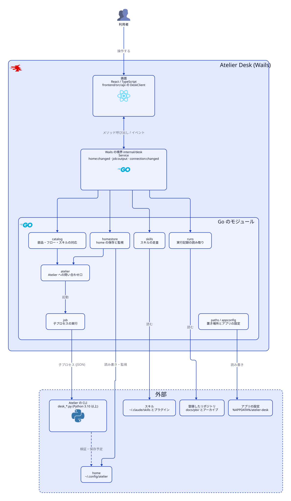

# Atelier Desk

Atelier を見る・設定する・評価する・改善するための Windows のデスクトップアプリです (Go + Wails、画面は React + TypeScript)。

- Atelier のルールそのものは持ちません。Atelier 同梱の Python CLI に問い合わせ、JSON で受け取って表示し、操作を Atelier に渡します。
- v1 は「見る・設定する」が対象です。フローを工程の図で見て、部品、呼んでいるスキル (本文・付属ファイル・版の経緯) へたどれます。home の個人の設定をフォームで編集でき、登録したリポジトリの実行記録とケースも並べて見られます。
- v2 以降のジョブ (Eval・ハーネス改善タスク) や本体の変更は、下の構成図の骨格の上に載せていきます。

## 構成

<picture>
  <source media="(prefers-color-scheme: dark)" srcset="docs/architecture/atelier-desk-dark.svg">
  
</picture>

図のソースは `docs/architecture/atelier-desk.d2` です。構成を変えたら、このファイルを直して `python ~/.claude/skills/arch-diagram/versions/v1.1/scripts/render.py docs/architecture/atelier-desk.d2` で 2 枚の SVG を描き直してください。

## 要件

- Go
- Node.js
- Wails v2
- Python 3.10 以上と Atelier v7.10 以上

## 開発の始め方

```bash
bash docs/pbi/tools/env.sh npm --prefix frontend install
bash docs/pbi/tools/env.sh wails dev
```

配布用のビルドは次のとおりです。

```bash
bash docs/pbi/tools/env.sh wails build
```

## リリース

`main` にマージして CI (`build`) が通ると、`release` ワークフローが次の 3 つを作ります。

- ブランチ `release/vX.Y.Z`
- タグ `vX.Y.Z`
- Windows と macOS (arm64) のビルドを添付した GitHub Release

版は前のタグの patch を 1 つ上げます。minor や major を上げたいときは、PR に `release:minor` か `release:major` のラベルを付けてからマージします。最初のリリースは `v0.1.0` です。
