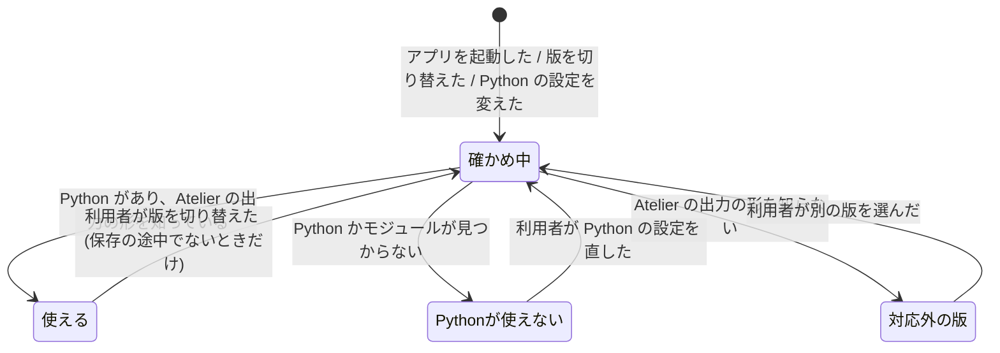
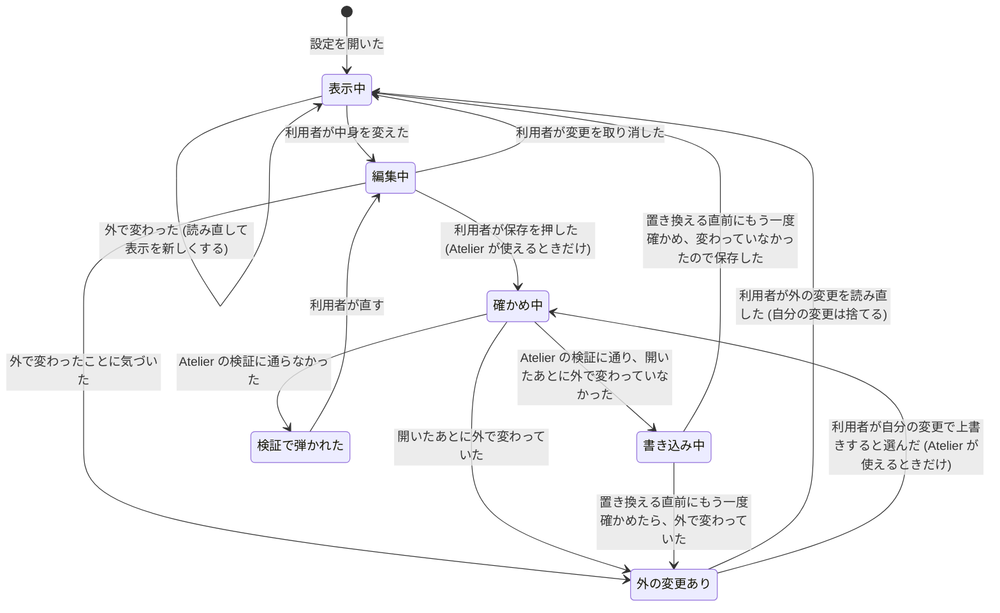

# Atelier Desk v1

- 作成日: 2026-11-13。状態: Ready (2026-11-13、状態の図に持ち主が合意)。
- 決定の経緯: design-flow v2.1 の grilling Q1〜Q25 (すべて推奨どおり)。
- 用語は `GLOSSARY.md`、技術の選択の理由は `docs/adr/0001-go-wails-and-atelier-cli-as-source.md`。

## Problem Statement

Atelier を使うほど、全体像を頭に入れたまま手を入れるのが難しくなっている。

- どのフローのどの工程に、どの部品が差さっていて、その部品がどのスキルを呼び、そのスキルの本文や版の経緯がどうなっているか、を一続きで見る手段がない。ファイルを `versions/` の中から探して読むしかない。
- 個人の設定 (モデル・振り分け・優先テンプレート・フロー) は `studio` で変えられるが、`studio` は使うたびにコマンドで立ち上げる 1 枚の HTML で、部品やスキルの情報とつながっていない。
- 実行記録とケースは各リポジトリの `docs/pbi/` に散らばり、横に並べて見られない。
- この先やりたいこと (部品の追加と PR、スキル単体の Eval、Atelier 全体の Eval、ハーネス改善タスク) を載せる土台がない。

## Solution

Windows のデスクトップアプリ「Atelier Desk」を作る。v1 は「見る・設定する」に絞り、v2 以降の実行系の機能が載る骨格を固める。

- 手元で有効な Atelier の版 (切り替えて他の版も見られる) を開き、フローを工程の図で見せる。工程の下の部品を押すと部品の詳細、そこから呼ぶスキルの詳細 (本文・付属ファイル・版の経緯) へたどれる。逆に、スキルからそれを呼ぶ部品とフローへも戻れる。
- `studio` の 4 タブ (エージェントとモデル・振り分け・優先テンプレート・フロー) をアプリに移す。保存先は今と同じ home で、`studio` と同時に動いても互いの変更を黙って消さない。
- 登録したリポジトリの実行記録とケースを一覧で見られる。
- Atelier のルールはアプリに持たず、Atelier の Python CLI に問い合わせる。アプリが知らない形の出力を返す Atelier は「対応外」と表示する。

## User Stories

### Atelier を開く

1. Atelier の利用者として、アプリを起動したら手元で有効な Atelier の版が自動で開かれてほしい。どこにあるかを毎回指定したくないから。
2. Atelier の利用者として、今どの版を見ているかを常に画面で確かめたい。見ている版と実際に動く版を取り違えないため。
3. Atelier の利用者として、`versions/` にある他の版に切り替えて見たい。版の間で何が変わったかを確かめたいから。
4. Atelier の利用者として、Python が見つからない・版が古い・必要なモジュールが無いときは、何が足りないかと直し方を画面で知りたい。黙って空の画面になると原因が分からないから。
5. Atelier の利用者として、使う Python を設定で指定したい。PATH の `python` 以外を使っている環境があるから。
6. Atelier の利用者として、アプリが対応していない Atelier の版を開いたら「対応外」と分かるようにしてほしい。間違った情報を正しいと思い込まないため。

### フローと部品を見る

7. Atelier の利用者として、フローの一覧から 1 つを選び、工程が左から右へ並んだ図で見たい。全体の流れを一目でつかみたいから。
8. Atelier の利用者として、各工程の下にその工程に差さっている部品を見たい。どこで何が動くかを知りたいから。
9. Atelier の利用者として、同梱のフローと home に置いた自分用のフローを見分けたい。どれが自分の変更か分かるように。
10. Atelier の利用者として、部品を押してその詳細 (題名・説明・呼び方・動く場所・費用の目安・対話が要るか・手順書) を見たい。部品を差し替える判断に使うから。
11. Atelier の利用者として、同梱の部品と home に足した部品を見分けたい。
12. Atelier の利用者として、部品が呼ぶスキルへ 1 回の操作で移りたい。部品の中身を本文まで追いたいから。

### スキルを深掘りする

13. Atelier の利用者として、`~/.claude/skills` とプラグインにあるスキルを一覧で見て、名前と説明で絞り込みたい。どんなスキルを持っているかを把握したいから。
14. Atelier の利用者として、スキルの SKILL.md を整形された表示で読みたい。
15. Atelier の利用者として、frontmatter (名前・説明・自動で呼ばれるか) を本文と分けて見たい。そのスキルがいつ呼ばれるかを判断したいから。
16. Atelier の利用者として、スキルの付属ファイルの一覧と中身を見たい。本文から参照される手順書やスクリプトまで追いたいから。
17. Atelier の利用者として、版で管理されているスキルなら、版の一覧・有効な版・CHANGELOG を見たい。いつ何がなぜ変わったかを知りたいから。
18. Atelier の利用者として、スキルを呼んでいる部品と、その部品が入っているフローを見たい。スキルを変えたときに影響する範囲を知りたいから。

### 個人の設定を変える

19. Atelier の利用者として、ランナーごとにモデル・有効か・課金の形を変えたい (`studio` のエージェントのタブと同じこと)。
20. Atelier の利用者として、一覧に無いモデルを手入力で足したい。
21. Atelier の利用者として、振り分けテンプレートを編集して保存したい。保存すると前の版が残ってほしい。
22. Atelier の利用者として、優先テンプレートを作る・直す・消す・同梱の例からコピーする、を行いたい。
23. Atelier の利用者として、優先テンプレートの適用を始め、期限切れへの答え (延長・止める・ずっと) を返したい。
24. Atelier の利用者として、自分用のフローを書く・消す (消すと同梱の同名に戻る) を行いたい。
25. Atelier の利用者として、Atelier の検証に通らない内容は保存されず、どこが悪いかを画面で知りたい。壊れた設定で Atelier を動かさないため。
26. Atelier の利用者として、`studio` や手作業で home のファイルが変わったら、アプリの表示が自動で新しくなってほしい。
27. Atelier の利用者として、自分が開いたあとに外で変わったファイルを保存しようとしたら、上書きせずに知らせてほしい。他で入れた変更を黙って消さないため。
28. Atelier の利用者として、知らせを受けたら、外の変更を読み直すか、自分の変更で上書きするかを選びたい。

### 実行記録を見る

29. Atelier の利用者として、実行記録を見るリポジトリを登録・解除したい。全ディスクを探されたくないから。
30. Atelier の利用者として、登録したリポジトリの実行記録を、リポジトリと日時で並べて見たい。
31. Atelier の利用者として、1 回の実行の PBI ごとの結果 (通ったか・手戻り・格上げ・保留とその原因) を見たい。
32. Atelier の利用者として、ケースを原因の分類 (仕様・規約・範囲・メモリ・モデル・環境) で絞り込みたい。手順書で直せる失敗がどれだけあるかを知りたいから。
33. Atelier の利用者として、アーカイブに移った実行記録も同じ一覧で見たい。

### 骨格 (v2 以降のため)

34. Atelier Desk の開発者として、長く走る子プロセスを「ジョブ」として起動・取り消し・時間切れ・出力の逐次受け取り・履歴の保存ができる土台がほしい。Eval やハーネス改善タスクをそこに載せるため。
35. Atelier Desk の開発者として、Atelier の CLI への問い合わせを 1 か所に集めたい。Atelier の出力の形が変わったときに直す場所を 1 つにするため。
36. Atelier Desk の開発者として、画面の文言を 1 か所に集めたい。あとで英語を足せるように。
37. Atelier の利用者として、アプリを `wails build` で作った 1 つの exe で起動したい。

## Implementation Decisions

### 全体の形

- Go + Wails。画面は React + TypeScript + Vite + Tailwind CSS。Windows 11 を主対象にし、macOS は CI でビルドできれば良い。パスと子プロセスの起動 (コンソール窓を出さない) の OS 差は、子プロセスの実行のモジュールの中に閉じ込める。
- Atelier のルール (部品・フロー・テンプレート・モデル選択の検証と判定) はアプリに実装しない。Atelier 同梱の Python CLI を子プロセスで呼び、JSON を受け取る (ADR 0001)。
- アプリは `studio` の後継。移行が終わるまでは両方が同じ home を読み書きでき、移行後に `studio` を Atelier から外すのは別の本体の変更で行う。
- 画面は日本語だけ。Atelier の出力に `ja` と `en` があれば `ja` を使う。文言は 1 か所にまとめる。

### 対象の切り分け

- 「見る・設定する」の対象は、`~/.claude/skills/atelier` の `ACTIVE` が指す版 (既定) か、画面で選んだ `versions/` の中の版。
- 「本体の変更」は v1 では扱わない。v2 で扱うときは `reeschan/atelier` の作業ブランチ (worktree) を対象にし、手元の `~/.claude/skills/atelier` は書き換えない。
- 個人の設定は home に保存する。home の位置は Atelier と同じ規則で解決する (Atelier に問い合わせる)。
- アプリ自身の設定 (使う Python・登録したリポジトリ・最後に見た版など) は home とは別の、アプリ用の設定ディレクトリ (Windows では `%APPDATA%` の下) に置く。

### Go 側のモジュール

- **Atelier への問い合わせ口**: Python の CLI を呼び、JSON を受け取り、`schema` を確かめて型に直す。知らない `schema` の版なら「対応外」の誤りを返す。起動時に Python の場所・版・必要なモジュールを確かめる。アプリから Atelier への呼び出しは、すべてここを通る。
- **ファイルの置き場所**: home・スキルのディレクトリ (`~/.claude/skills`・プラグインのキャッシュ)・Atelier の版のディレクトリ・登録したリポジトリの根元をひとまとめにした値。起動時に 1 回組み立て、各モジュールに外から渡す。
- **スキルの走査**: スキルのディレクトリを読み、スキルの一覧・frontmatter・本文・付属ファイル・版の情報 (`versions/`・`ACTIVE`・`CHANGELOG.md`) を返す。SKILL.md と frontmatter の読み取りは Atelier のルールではないので、ここで直接行う。
- **部品とフローの読み取り**: 問い合わせ口を通して部品とフローの一覧を受け取り、「部品 → 呼ぶスキル」「スキル → 呼ばれる部品 → 入っているフロー」の対応を組み立てる。
- **home の保存と監視**: home のファイルを読み書きする。書く前に Atelier の検証 CLI を通し、通らなければ書かない。書くときは前の版を残す (`studio` の `routing.prev.json` と同じ方式)。ファイルの変化を監視して画面に知らせる。読んだ時点の中身の指紋を持ち、保存時に指紋が違えば書かずに「外で変わった」を返す。書き込みは一時ファイルに書いてから置き換え、置き換える直前に指紋をもう一度確かめる。保存の途中は、版の切り替えと Python の設定の変更を受け付けない (状態の図の検査で見つかった穴の直し)。
- **実行記録の読み取り**: 登録したリポジトリの `docs/pbi/` (`runs.jsonl`・`cases.jsonl`) とアーカイブ先を読み、実行・PBI・ケースの一覧を返す。ケースは `atelier.case/1` の形を読む。
- **子プロセスの実行 (ジョブ)**: 起動・取り消し・時間切れ・出力の逐次受け取り・履歴の保存を持つ。v1 では問い合わせ口が短い呼び出しに使うだけで、ジョブの一覧画面は作らない。v2 以降の Eval・ハーネス改善タスクはここに載る。Claude を動かすときは `claude -p` を子プロセスとして呼び、API キーを使う Agent SDK は使わない。

### 画面との境界

- Wails に公開するメソッドの集まりを 1 つの境界にする。画面からはこの境界の型付きのクライアントだけを使う。
- ファイルの変化・ジョブの出力は、Wails のイベントで画面に流す。

### Atelier 側に足すもの (本体の変更として PR で入れる)

- 部品の一覧・フローの一覧と中身・モデルとランナーの一覧・home の状態・home の位置を、`schema` つきの JSON で出す CLI の出力。既存の CLI (`component.py list`・`templates.py check/status` など) に機械向けの出力を足す形を優先する。
- home に書く前に使う検証の CLI (`studio/serve.py` が書く前に行っている検証と同じもの) を、ファイルを渡して結果を JSON で返す形で呼べるようにする。
- `schema` の名前と版の一覧 (例: `atelier.components/1`)。アプリはこの版で対応範囲を判定する。

### 画面

- **フロー**: フローの一覧と、選んだフローの図。工程を左から右へ、工程の下にその工程の部品を並べる。描画は React Flow (xyflow)。v1 は見るだけ。
- **部品の詳細**: 部品の情報と、呼ぶスキルへのリンク。
- **スキル**: 一覧と絞り込み。詳細は本文・frontmatter・付属ファイル・版・呼んでいる部品とフロー。
- **設定**: `studio` の 4 タブをフォーム形式で移植する (フローの編集もフォーム)。保存できなかったときは Atelier の検証の結果をそのまま見せる。外で変わったときは「読み直す / 上書きする」を選ばせる。
- **実行記録**: リポジトリの登録と、実行・PBI・ケースの一覧と絞り込み。
- 画面の上部に、見ている Atelier の版と、Atelier との接続の状態 (使える・Python が無い・対応外) を常に出す。

### 状態の図

アプリと Atelier の接続の状態:

保存の途中 (保存を確かめ中・書き込み中) は、版の切り替えと Python の設定の変更を受け付けない。

個人の設定 1 つ分の編集と保存:

- 「外の変更あり」から上書きを選んだ場合も、もう一度「確かめ中」を通る。その間にさらに外で変わったら、再び「外の変更あり」に戻る。
- 書き込みは「一時ファイルに書く → 置き換える直前に中身の指紋をもう一度確かめる → 置き換える」の順に行う。直前の確認と置き換えの間のごく短い時間に外で変わる可能性は OS の上では消しきれない。`studio` は移行後に外し、手作業の編集はロックを取れないため、この残りの隙は受け入れる (前の版が残るので取り戻せる)。
- 状態の図の検査: 2 つの図を「接続」「編集」「home のファイル」の 3 つの並行する部分にまとめ、pstack の `/statechart` (from-chart、TLC) で検査した。最初の図では 3 種類の穴 (上書きを選ぶ道に「Atelier が使えるとき」の条件がない・保存の途中に版を切り替えられる・指紋の確認と書き込みの間に外で変わると黙って上書きする) が見つかり、上の図はそれを直したもの。直した図では 4 つの規則 (確かめ中・Python が使えない・対応外の版のときに書き込まない、外の変更を黙って上書きしない) がすべて守られた (46 状態、規則を破る状態 0)。「版の食い違い」「検証に通らない内容」「前の版を残さない」の 3 つの規則は、この抽象度の図では表せないので、テストで確かめる。

## Testing Decisions

- 良いテストは、外から見える振る舞い (画面との境界のメソッドが返すもの、home に書かれるファイル、出すイベント) だけを確かめ、モジュールの中の作りには触れない。
- **合意済みの seam** (grilling Q19):
  1. **Atelier への問い合わせ口**: テストでは偽物に差し替え、決まった JSON (対応外の `schema`、壊れた出力、Python が無い場合を含む) を返させる。部品とフローの読み取り・home の保存 (検証の結果)・接続の状態の遷移は、この偽物を使って確かめる。
  2. **ファイルの置き場所**: テストでは `testdata/` の固定のディレクトリ (home・スキル・版つきのスキル・実行記録を持つリポジトリ) を渡す。スキルの走査・実行記録の読み取り・home の監視と外の変更の検出は、これで確かめる。
  3. **画面との境界**: フロントのテスト (Vitest + Testing Library) では、型付きの偽物のクライアントに差し替え、画面の状態 (接続の状態の表示・保存できなかったときの表示・外の変更の選択) を確かめる。
- 本物の Atelier に対する結合テストは少数にする: 手元の有効な版に対して、Atelier に足した JSON 出力が知っている `schema` で返ること、検証の CLI が通る内容と通らない内容を見分けることを確かめる。
- 状態の図の `%% never` の規則は、それぞれ 1 つ以上のテストで破れないことを確かめる。
- 子プロセスの実行は、取り消し・時間切れ・出力の逐次受け取りを、短いテスト用のプロセスで確かめる。
- 先行例: Atelier の `studio/test_serve.py` (home の読み書きと検証の API のテスト)、`test_no_window.py` (コンソール窓を出さない子プロセスの起動)。アプリのテストは、これらが確かめていることを Go 側で引き継ぐ。

## Out of Scope

- 本体の変更の支援 (部品の追加、作業ブランチと PR の作成)。v2 の最初の仕様で扱い、「スキルの追加・拡張」が何を指すかもそこで決める。
- スキル単体の Eval (v2 の 2 番目)。
- Atelier 全体の Eval (v2 の 3 番目)。
- ハーネス改善タスク (harness2 との連携。v2 の 4 番目)。
- ジョブの一覧画面。
- フローの図の上でのドラッグ編集。
- スキルの使われた回数などの統計。
- 署名・自動更新・GitHub Releases での配布。
- 英語の画面。
- `studio` を Atelier から外すこと (移行が終わったあとの別の本体の変更)。
- Atelier を動かすこと (`conductor.py start` などの実行)。

## Further Notes

- GitHub の `reeschan/atelier-desk` は実装に入るときに作り、公開範囲はそのときに確かめる。今は手元の `~/dev/atelier-desk` に `git init` しただけ。
- Atelier 側に足す JSON 出力と検証の CLI は、アプリの実装より先に `reeschan/atelier` へ PR で入れる必要がある (派生ブランチ → PR → マージ後に手元の版を作る、の流れ)。アプリの v1 は、それが入った Atelier の版を対応範囲の下限にする。
- 今の Atelier の有効な版は v7.6。
